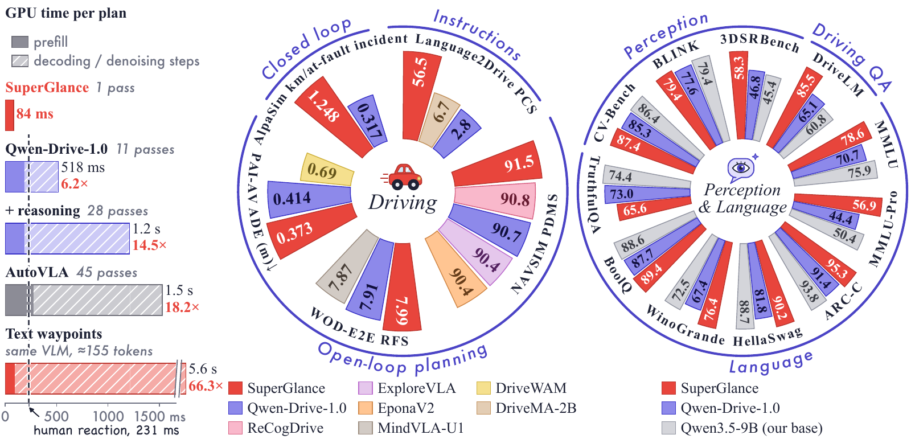
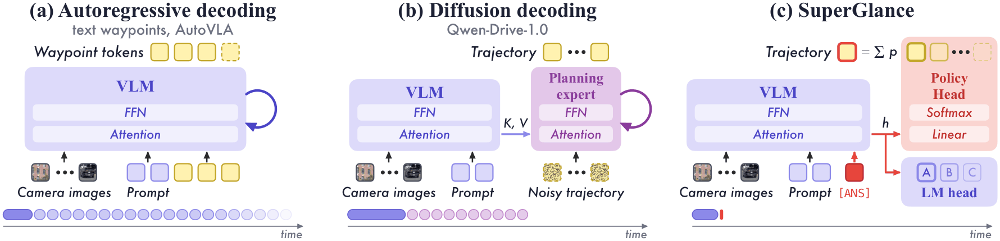
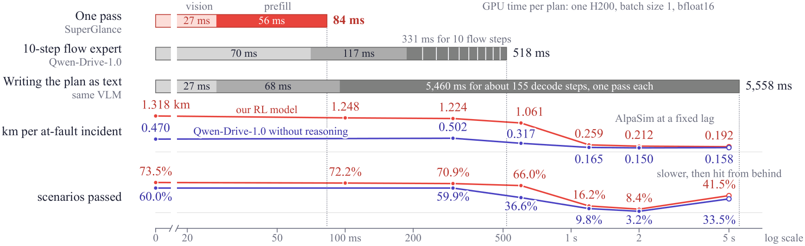

<div align="center">

<picture>
  <source media="(prefers-color-scheme: dark)" srcset="docs/wordmark_dark.svg">
  
</picture>

### Driving at a Glance with a Vision-Language Model

[](https://guobapei.github.io/SuperGlance/SuperGlance.pdf)
[](https://guobapei.github.io/SuperGlance/)
[](https://guobapei.github.io/SuperGlance/#video)
[](https://huggingface.co/pei2333/SuperGlance-9B)
[](https://huggingface.co/datasets/pei2333/SuperGlance-QA)
[](#main-results)
[](LICENSE)

[Jieyuan Pei](https://scholar.google.com/citations?user=xAAOO_0AAAAJ)<sup>1,2,3*</sup>, Xin Yan<sup>4*</sup>, [Mingwei Xu](https://scholar.google.com/citations?user=jOZPNeQAAAAJ)<sup>5</sup>, Haiyi Zhang<sup>3</sup>, Siyu Zou<sup>2</sup>, Zhangyi Hu<sup>2,3</sup>,<br>
Zhuoxuan Li<sup>6</sup>, Yuguang Yang<sup>7</sup>, [Rongjunchen Zhang](https://scholar.google.com/citations?user=Ae41dcUAAAAJ)<sup>2†</sup>, Cheng Chi<sup>6</sup>, Hui Xiong<sup>3✉</sup>, [Yan Wang](https://scholar.google.com/citations?user=QOZnsYYAAAAJ)<sup>1✉</sup>

<sub><sup>1</sup>Institute for AI Industry Research (AIR), Tsinghua University · <sup>2</sup>HiThink Research</sub><br>
<sub><sup>3</sup>The Hong Kong University of Science and Technology (Guangzhou)</sub><br>
<sub><sup>4</sup>Agency for Science, Technology and Research (A&#42;STAR), Singapore</sub><br>
<sub><sup>5</sup>University of Washington · <sup>6</sup>Renmin University of China · <sup>7</sup>Beihang University</sub><br>
<sub><sup>&#42;</sup>Equal contribution · <sup>†</sup>Project leader · <sup>✉</sup>Corresponding authors</sub>

</div>

<p align="center"></p>
<p align="center"><sub>SuperGlance plans in one forward pass, 6.2 times faster than Qwen-Drive-1.0, and leads it on ten of eleven QA benchmarks and on every driving benchmark (Figure 1 of the paper; ring bars start above zero).</sub></p>

## News

- **2026/11** The [paper](https://guobapei.github.io/SuperGlance/SuperGlance.pdf) is out (arXiv link soon). Code, the three checkpoints and the [SuperGlance-QA](https://huggingface.co/datasets/pei2333/SuperGlance-QA) data are released, with the [project page](https://guobapei.github.io/SuperGlance/) and its [video](https://guobapei.github.io/SuperGlance/#video).

## Highlights

- **One hidden state, one pass.** Before a VLM writes its first token, it has already read the scene into one hidden state. SuperGlance reads it with a linear Policy Head that scores a fixed set of 5,273 candidate trajectories, so a plan takes one forward pass.
- **Exact expected reward.** With the candidate set fixed, every candidate's reward is computed offline, so supervised targets can be reward-weighted and reinforcement learning maximizes the exact expected reward over all candidates.
- **Still a VLM.** Multiple-choice training, with questions built against shortcuts and answered in two option orders, keeps the VLM's visual abilities in the same pass: SuperGlance answers visual multiple-choice questions as well as its base VLM does by decoding.
- **84 ms per plan.** 6.2 times faster than Qwen-Drive-1.0 (518 ms), and it plans at least as well on NAVSIM, PAI-AV and WOD-E2E. In AlpaSim closed loop, with GPU time charged as delay, its lead in km per at-fault incident grows from 2.8 to 3.9 times.

## Method

<p align="center"></p>

SuperGlance turns a vision-language model (VLM) into a driving policy that plans in one forward pass. The model reads the
front camera (the current frame and three past frames), the ego state and the navigation command. A linear Policy Head on
the hidden state at the answer position scores a fixed set of candidate trajectories (8 poses at 2 Hz over 4 s), and the
plan is the probability-weighted mean of the 64 most probable candidates at temperature 0.2. The same hidden
state answers multiple-choice questions through the language-model head's option-letter logits, also without generating.
The VLM is Qwen3.5-9B with rank-32 LoRA adapters, trained in three stages: multiple-choice question answering on general
images and text (stage 1) and on driving scenes (stage 2) keeps the VLM's visual abilities; stage 3 trains the policy,
first supervised toward a reward-weighted target over the candidates, then with reinforcement learning (RL) on the exact
expected reward over all candidates.

| stage | data | objective | start | steps x rows |
|---|---|---|---|---|
| 1 general QA | 1.16 M visual and text questions | joint Brier policy gradient on two option orders (32 draws) + 0.1 KL to the base | Qwen3.5-9B | 7,813 x 64 |
| 2 driving QA | DriveLM questions + stage-1 questions | the same, KL to the stage-1 model | stage 1, merged | 3,000 x 64 |
| 3 supervised | NAVSIM, PAI-AV, WOD-E2E rows + QA replay | log score toward a soft target over 5,121 candidates; QA rows as stage 2, KL 0.1 to stage 2 | stage 2, merged | 20,900 x 128 |
| 3 last phase | the supervised pool with its WOD-E2E rows replaced by training frames 135-165, around the rated frame (new targets, WOD-E2E weight 0.4) | the same | the supervised run | 2,500 x 128 |
| 3 RL | NAVSIM, PAI-AV, WOD-E2E rows | exact expected reward over all 5,273 candidates + 0.3 KL to the supervised policy | last phase, head refit to 5,273 | 2,000 x 64 |

Stages 1 and 2 are merged into the model before the next stage; stage 3 trains one adapter and the Policy Head. All runs
use 8 GPUs.

## Main results

The final model, SuperGlance-9B, as reported in the paper:

| benchmark | metric | SuperGlance-9B |
|---|---|---|
| NAVSIM v1.1 navtest (Table 4) | PDMS | 91.5 |
| WOD-E2E test (Table 5) | RFS / ADE 3 s / ADE 5 s (m) | 7.99 / 1.19 / 2.55 |
| PAI-AV open loop (Table 6) | ADE 3 s / 5 s (m), one plan | 0.373 / 1.076 |
| AlpaSim, 916 scenarios (Table 3), no delay | km per at-fault incident / pass (%) | 1.318 / 73.5 |
| AlpaSim, delay = GPU time per plan | km per at-fault incident / pass (%) | 1.248 / 72.2 |
| Language2Drive, NAVSIM track (Table 7) | PCS | 56.5 |
| DriveLM / 3DSRBench / CV-Bench (Table 2) | accuracy (%) | 85.51 / 58.29 / 87.40 |
| GPU time per plan (one H200) | ms | 84 |

<p align="center"></p>
<p align="center"><sub>Time per plan and distance in closed loop (Figure 6 of the paper). Top: 84 ms of GPU time per plan in our single pass, 518 ms in Qwen-Drive-1.0 with 10 flow steps and 5,558 ms when our VLM writes the plan as text. Bottom: in AlpaSim, with each time as the plan's delay, km per at-fault incident holds for both planners up to 300 ms and drops beyond.</sub></p>

## Installation

Training and inference (8 GPUs for training, one for most evaluations):

```bash
pip install -r requirements.txt
pip install --no-deps triton==3.7.1
```

The pinned versions are those of the paper's runs: torch 2.10, transformers 5.17, peft 0.21, DeepSpeed 0.18.1 and
flash-linear-attention 0.5.2 for Qwen3.5's linear-attention layers, with torchvision 0.25 (the release that pairs with
torch 2.10). Triton 3.7.1 is installed in a second step without the dependency check, because torch's wheel pins another
Triton; this is how the paper's environment was built. On Hopper GPUs flash-linear-attention 0.5.2 refuses its gated
backward kernel under Triton 3.4.0 to 3.7.0, which give wrong results. The stage-1 and stage-2 scripts set
`FLA_TILELANG=0` (flash-linear-attention's Triton kernels), as the paper's runs did; it has no effect without TileLang.
The paper's supervised stage-3 runs also loaded Liger kernels and causal-conv1d through a path overlay; the release uses
the stock kernels, and `liger-kernel` and `causal-conv1d` are an optional speed-up.

Other environments, installed as their projects describe:
- NAVSIM devkit v1.1 with the nuPlan devkit: the executor (the PDM simulator), the NAVSIM rewards and scene export, and
  the instruction rows. If NAVSIM's comfort scores come out all zero, set `OPENBLAS_CORETYPE=Haswell` (seen with numpy
  1.23.4 / OpenBLAS 0.3.20 on Intel Sapphire Rapids CPUs).
- AlpaSim with its `alpasim_grpc` package (closed loop), the PhysicalAI-AV devkit `physical_ai_av` (PAI-AV rows), the
  `waymo-open-dataset` package (WOD-E2E), the Language2Drive SDK and its scorer (Language2Drive), and Qwen-Drive-1.0's
  repository for its PAI-AV rows.

Run every command from the repository root (`python -m superglance....`).

## Weights and data

### Weights

| repository | content | in the scripts |
|---|---|---|
| [SuperGlance-9B](https://huggingface.co/pei2333/SuperGlance-9B) | the final model (stage-3 RL): the merged model with its 5,273-row Policy Head, `candidates_k5273.npy`, and `adapter/`, the LoRA and Policy Head before the merge, which the paper's numbers were read with | `ADAPTER=<SuperGlance-9B>/adapter`, `CANDS=<SuperGlance-9B>/candidates_k5273.npy` |
| [SuperGlance-9B-Stage2](https://huggingface.co/pei2333/SuperGlance-9B-Stage2) | the stage-2 model (driving QA), stage 3's base | `BASE` / `STAGE2` |
| [SuperGlance-9B-Stage1](https://huggingface.co/pei2333/SuperGlance-9B-Stage1) | the stage-1 model (general QA), stage 2's base | `STAGE1` |

```bash
huggingface-cli download pei2333/SuperGlance-9B-Stage2 --local-dir weights/SuperGlance-9B-Stage2
huggingface-cli download pei2333/SuperGlance-9B --local-dir weights/SuperGlance-9B
```

### Stages 1 and 2: the QA dataset

The questions are released as [SuperGlance-QA](https://huggingface.co/datasets/pei2333/SuperGlance-QA):

```
stage1/train/<source>.jsonl    one file per source with its released rows
stage2/train/<source>.jsonl
counts.json                    per source and stage: rows (trained on), uploaded (released), held (why the others are not)
SCHEMA.md                      every field
images/text/blank.png          the blank image of the text-only questions
build/build_images.py          writes every other image from its source dataset's public release (build/README.md)
```

Each line is one question: `question` (without options), `answers` (the options in the order the model sees them,
shuffled once with a fixed seed), `gold_index`, `source`, `sampling_task` and `sampling_bucket` (the mixture's groups),
`images` (one path relative to the data directory), and `row` (its line in the paper's training file). Yes/no rows also
carry `yes_index`; the remaining fields (ids, the source's own options and answer, image references for the image build)
are kept and ignored by the trainer.

A question is released when we generated its options or its question. The questions we used as published, with the
source's own question and options, are not:
all of [SAT](https://huggingface.co/datasets/array/SAT-v2) (`SAT`),
[Social IQa](https://huggingface.co/datasets/allenai/social_i_qa) (`text_siqa`),
[PIQA](https://huggingface.co/datasets/ybisk/piqa) (`text_piqa`) and AI2D from
[The Cauldron](https://huggingface.co/datasets/HuggingFaceM4/the_cauldron) (`ai2d`), and the source's own yes/no questions
of GQA and of ChartQA (from The Cauldron).
`counts.json` gives the numbers per source. They are rebuilt from their original releases with the stage-1 and stage-2
builders (Building the training data), not dropped: the train/dev split, the de-duplication and every line number depend
on all sources, and option shifts and mixture draws are keyed by line number. `build_qa` takes each released row and fills
every other line from the rebuilt pool, after checking every source's counts against `counts.json` and that each released
row sits on the rebuilt pool's line with the same id:

```bash
ROOT=data/qa bash scripts/build_qa.sh                       # the pools, from the public sources (Building the training data)
python -m superglance.data.build_qa --hf <dataset snapshot> --stage 1 --rebuilt data/qa/stage1_adapted_g_20260926 --out data/stage1
python -m superglance.data.build_qa --hf <dataset snapshot> --stage 2 --rebuilt data/qa/stage2_drivelm_20260925 --out data/stage2
python <dataset snapshot>/build/build_images.py <dataset snapshot> data/stage1 --stage stage1 ...   # the released rows' images
```

The result is the paper's `train.jsonl` row for row. Without `--rebuilt`, `build_qa` writes nothing while a source is not
released in full (`--allow-incomplete` writes the released rows alone, for a smoke test). The development split is not
released: without `dev.jsonl` the trainer runs no evaluation and keeps the last step, the checkpoint both of the paper's QA
runs selected on their development split. The DriveLM test questions of our scene split are not released either.

### Stage 3: policy pools

Stage 3 trains on pools built from NAVSIM (navtrain and OpenScene), PAI-AV and WOD-E2E, which their licenses do not let us
redistribute, plus QA replay rows (the stage-2 questions, held sources included). `scripts/build_pools.sh` rebuilds them
(Building the training data). A pool directory holds `train.jsonl` and `dev.jsonl` and, per manifest stem, memory-mapped
arrays with one row per policy row:

| file | shape | content |
|---|---|---|
| `<stem>_targets.npy` | N x K, float32 (float16 also read) | the supervised target over the K candidates (normalized when read) |
| `<stem>_rewards.npy` | N x K, float32 | each candidate's reward: PDMS x DDC minus 10 when NC, DAC or TTC is below 1 (NAVSIM), -0.2 x ADE (PAI-AV), RFS / 10 (WOD-E2E) |
| `<stem>_ref.npy` | N x K, float16 | RL pools only: the supervised policy's head logits (`scripts/train_stage3.sh reference`) |

A policy row has:
- `no_options: true`, `fixed_order: true`, `compact: {"k": K, "row": j}` (its row in the arrays), and `gold_index` with
  `correct_answer` (`t%04d`): the argmax of the target;
- `question`: the scene prompt of `superglance.data.scene` (the sentence "the image is its front camera" exactly once, ego
  speed and acceleration, past positions, navigation command, then any instruction);
- `images`: the current front frame, then with `history: true` the frames 1.5, 1.0 and 0.5 s earlier, oldest first,
  each stored as `superglance.model.history` makes it (at most 174,080 pixels, JPEG quality 92);
- `source`, `sampling_task`, `sampling_bucket`. The source names the configs mix: `navtrain`, `pai_human`, `pai_dagger`,
  `wod` and the instruction rows `if_navtrain_{follow,junction,lane,speed,stopgo}`, `if_pai_{follow,speed,stopgo}`,
  `if_wod_pace` (supervised pools, plus the stage-2 QA sources); `navtrain`, `pai_human`, `wod` (RL pool).

K is 5,121 for the supervised pools and 5,273 for RL.

### Candidates

The library has 5,121 candidates: k-means 4,096 over the 4-s futures of NAVSIM's training scenes, one standing-still
trajectory, and 1,024 high-speed candidates from k-means over PAI-AV rows at 13 m/s or more. Before RL it grows to 5,273
with 152 candidates built by rule (84 braking, 68 medium-speed curves and ramps). `scripts/build_candidates.sh` builds both
(Building the training data); `candidates_k5273.npy` in SuperGlance-9B is the 5,273-candidate library, and its first 5,121
rows are the supervised library.

## Quick start

CPU self-checks (about a minute), then the final model on PAI-AV open loop (one GPU), which prints Table 6's row:

```bash
python -m pytest -q tests
PAI_ROOT=<PhysicalAI-AV root> GOLD=<1005_7cam_gold_eval_metadb_public.parquet> BASE=weights/SuperGlance-9B-Stage2 \
  ADAPTER=weights/SuperGlance-9B/adapter CANDS=weights/SuperGlance-9B/candidates_k5273.npy bash scripts/eval_pai.sh
```

The one-plan ADE at 3 s / 5 s is the `mean` line of `runs/pai/one_superglance_test.txt`, the best of six is `min6` in
`runs/pai/ade_superglance_test.txt` (PAI-AV open loop, below). The other benchmarks run the same way, with the
inputs their sections name.

## Training

```bash
BASE=<Qwen3.5-9B, local snapshot> DATA=data/stage1 bash scripts/train_stage1.sh      # -> runs/stage1/merged
DATA=data/stage2 bash scripts/train_stage2.sh                                        # -> runs/stage2/merged
POOL_SFT=<pool> POOL_LAST=<pool> POOL_RL=<pool> CANDS=<5,121 candidates> REFIT_ROWS=<rows> REFIT_DATA=<refit data> \
  HELDOUT=<navtrain held-out tokens> bash scripts/train_stage3.sh                    # sft, last, refit, reference, rl
```

- `BASE` is a local directory with the full snapshot: the merge reads its `model.safetensors.index.json`.
- Stage 1 needs gradient checkpointing on 80 GB GPUs, and its config has it on. The paper's run had it off for steps
  1-4,000, stopped out of memory near step 4,056 and continued from checkpoint-4000 with it on: the same updates, more
  compute. A stopped run continues with `bash scripts/train_stage1.sh --resume-from-checkpoint`.
- Stage 3 runs five steps; pass step names to run some of them. Stage 3's QA rows keep the stage-1/2 objective
  (`pair_reward` "joint").
- RL's objective is `soft_objective` "exact_rl": the exact expected reward over every candidate, advantage
  r - E_p[r] with no draws and no normalization, plus the KL term. Its earlier name "grpo" is still accepted. The RL
  config's `reward_samples` and `pair_reward` are read but unused: the loss uses no draws and the RL pool has no QA rows.
  The config key `policy_head` (earlier name `choice256`) adds the Policy Head of `choice_k` rows.

### Head refit

Between the last supervised phase and RL, the Policy Head is widened from 5,121 to 5,273 rows on the last phase's
features (`refit` step): `superglance.eval.features` on five sets (navtrain fit and held-out scenes, a PAI-AV subset,
navtest, PAI-AV val and test), an L-BFGS fit of the 152 new rows with the language model and the old rows frozen
(`superglance.refit.fit`: each new row starts from its nearest old candidate's row with the bias lowered by 4; L2 weights
1e-1, 1e-2 and 1e-3, chosen on the navtrain held-out PDMS and the PAI-AV check ADE), the widened adapter
(`superglance.refit.extend_head`), and a stop rule: navtest PDMS at most 0.1 below the 5,121-row head's and PAI-AV val
ADE@3 s at most 0.005 m above it. `REFIT_ROWS` comes from `superglance.refit.rows`; `REFIT_DATA` holds the 5,273
candidates, the navtrain targets over them, the PAI-AV subset and the candidate score tables that `superglance/refit/fit.py`
names. `REFIT` defaults to the step's output; set it to start `reference` and `rl` from another 5,273-row adapter.

### Ablations

`scripts/train_ablation.sh <row>` trains one row of the ablation tables. Each row is a stage-3 step with one switch: a
config of `configs/ablations/` (checked against its release config to differ in exactly that switch), a pool, the start
model, or the trainer module (`superglance.ablations.regression`, `.text`, `.rl_estimators`). The script's header lists
every row and its inputs:

| table | rows |
|---|---|
| Table 8, Output and target | `text`, `regression`, `imitation_history`, `reward_history` |
| supplement, One change at a time | `reward_history`, `reward_current`, `no_rollout_rows`, `imitation_history`, `regression`, `no_wod_rows`, `no_pai_rows`, `no_stages12`, `no_question_data`; "No PDM simulator" is the main model under `scripts/eval_alpasim.sh` with `EXEC=plan` |
| supplement, RL step | `reward_current` (no RL), `rl_sampled`, `rl_exact_normalized`, `rl_exact`, `rl_exact_beta01`, `rl_imitation` |
| supplement, AlpaSim results by training recipe | `imitation_current`, `imitation_history`, `reward_current`, `reward_history`, the RL rows, `rl_original_set`, and the main models |
| Table 7, no instruction rows | `no_instruction_rows` |

The imitation pools come from `NAV_TARGET=imitation bash scripts/build_pools.sh ...`, the current-frame pools from its
`stage_cf` step, and the regression and text rows need the trajectory targets first
(`python -m superglance.ablations.traj_targets`). Each RL start model needs its own pool directory, as the KL reference
`train_ref.npy` is written into it. A row's adapter is evaluated as the main model's (Evaluation), with `CANDS` the 5,121
library and `HIST=0` for the current-frame rows. The paper's ablation rows were trained with the stage-1/2 objective as
implemented before its correction (supplement, "Objective"), except the supervised model without instruction rows; the
release has the corrected objective, so a rerun gives these rows on the corrected models.

## Evaluation

The plan is read from the Policy Head as the softmax-weighted mean (temperature 0.2) of the 64 most probable
candidates' poses (`superglance.eval.readout`). In closed loop the executor runs the plan through NAVSIM's PDM simulator
from the car's current state, starting from the steering angle reached under the previous plan unless that angle is more
than 0.2 rad from the yaw-rate estimate (then from the estimate), and returns 40 poses 0.1 s apart
(`python -m superglance.executor.stitched`, JSON lines on stdin and stdout; `--check` tests it).

| paper | script | status |
|---|---|---|
| Table 2, base and stages 1-3 | `scripts/eval_qa.sh`, then `python -m superglance.eval.qa_table` | reproducible |
| Table 2, Qwen-Drive-1.0 | `scripts/eval_qa.sh` on its weights as a plain VLM | partly: the weight conversion is not included |
| Table 2, decoded replies; supplement, Letter and decoded replies | - | not included |
| Table 3, our rows; Fig. 6 bottom, our lags | `scripts/eval_alpasim.sh` (`DELAY_US`) | reproducible |
| Table 3 and Fig. 6, Qwen-Drive-1.0's rows | - | not included (its AlpaSim driver) |
| Fig. 6 top; supplement, Time per plan | - | not included (the latency harness) |
| Table 4 | `scripts/eval_navsim.sh` | reproducible |
| Table 5 | `scripts/eval_wod.sh` | reproducible (the challenge server scores the package) |
| Table 6 | `scripts/eval_pai.sh`; Qwen-Drive-1.0's rows `scripts/eval_pai_qwen_drive.sh` | reproducible |
| Table 7 | `scripts/l2d_run.sh`, then `scripts/eval_l2d.sh` | reproducible (the SDK and the scorer are external) |
| Table 8 and the supplement's ablation tables | `scripts/train_ablation.sh`, then the evaluation scripts | Policy Head rows reproducible; text and regression rows: training only, their readouts are not included |
| supplement, Coverage of NAVSIM scenes | `scripts/build_candidates.sh coverage` | partly: needs the held-out scene lists and the 5,273 candidates' scores on them |
| supplement, at-fault collision counts | `superglance.alpasim.collisions` (last step of `scripts/eval_alpasim.sh`) | reproducible |
| supplement, readout k and temperature | `python -m superglance.eval.pai_topk` | reproducible |
| supplement, frozen features | - | not included |
| the figures | - | the plotting scripts are not included; the data of Figs. 5c, 6 (bottom) and 7 and of the supplement's closed-loop and qualitative figures are outputs of the scripts above |

### NAVSIM navtest

```bash
BASE=<stage-2 model> ADAPTER=<adapter> CANDS=<candidates> NAVTEST=<navtest scene export> HIST=<history frames> \
  NAVSIM_PY=<python of the NAVSIM environment> bash scripts/eval_navsim.sh
```

`NAVTEST` is `superglance.builders.pools.navsim_export`'s navtest rows (with each scene's metric cache) and `HIST`
`superglance.builders.pools.history_nav`'s output. The script extracts the features with the past frames (a scene without
all three reads its current frame alone), reads the plan and scores it with the NAVSIM v1.1 PDM scorer; the `mean` line
is the paper's readout, printed beside argmax and medoid.

### WOD-E2E test

```bash
WOD_TEST=<test TFRecord shards> WOD_LIST=<test_sequence_frames_for_submission_as_list.txt> BASE=<stage-2 model> \
  ADAPTER=<adapter> CANDS=<candidates> bash scripts/eval_wod.sh
```

The WOD-E2E protos come from the `waymo-open-dataset` package, or set `WOD_PROTOS` to the Python modules generated from its
`.proto` files. The script builds the rows of the listed frames (front camera, re-projected to CAM_F0; the test split has
no past frames), extracts the features, reads `mean02` (the paper's readout) and `mbr02`, and writes and checks one
submission package per readout (`runs/wod/sub/`). It uploads nothing: it prints the `wod_submit fill` command for the
account, method and author fields, and the filled `mean02` package is uploaded on the challenge page. Table 5's row is the
server's RFS and ADE of that package.

### PAI-AV open loop

```bash
PAI_ROOT=<PhysicalAI-AV root> GOLD=<1005_7cam_gold_eval_metadb_public.parquet> BASE=<stage-2 model> ADAPTER=<adapter> \
  CANDS=<candidates> bash scripts/eval_pai.sh
```

Our version of a 700-frame leakage-free subset: the 140 test clips of the public gold eval list of the alpamayo recipes,
five frames per clip at 5.1 s + (-2 ... 2) s. `PAI_ROOT` holds `clip_index.parquet`, `camera/camera_front_wide_120fov/`,
`labels/egomotion*/` and `calibration/` as the dataset ships them. Steps: rows (`superglance.eval.pai_rows`: the front wide
frame re-projected to nuPlan's CAM_F0, ego history, velocity, command, the logged future at 10 Hz), past frames
(`pai_history`; `HIST=0` for a model without them), features, ADE (`pai_ade`) and the one-plan readout (`pai_readout`).
`runs/pai/ade_<NAME>_test.txt` has the argmax (`top1`) and the six most probable candidates (`avg6`, `min6`) at 3 s / 5 s
over the 700 frames and the 140 T0 frames, beside the oracle candidate and constant velocity; Table 6's best-of-six cells
are `min6` over all frames. Its one-plan cells are the `mean` line of `runs/pai/one_<NAME>_test.txt`: the top-64 mean at
temperature 0.2, densified to the log's 10 Hz by a cubic spline through the origin and the 8 poses, clamped at the logged
velocity at 0 s and natural at 4 s, with 4-5 s linear (`superglance.eval.pai_decode`); the argmax, densified linearly, is
printed beside it. `SPLIT=val GOLD=-` builds the validation rows.

The supplement's readout settings come from the validation rows and each model's features:

```bash
python -m superglance.eval.pai_topk runs/pai/pai_openloop_val.jsonl runs/pai/topk_val.json 0.2 1,32,64,128,256,1024,all \
  sft=<features dir>=<candidates> rl=<features dir>=<candidates>
```

prints ADE at 3 s / 5 s per k, paired against k = 64 and against the argmax, with 95 % intervals over logs. The temperature
was chosen with k = 64 at 1, 0.5, 0.2, 0.1, 0.05 and 0.02 (one call per temperature, `64` as the k list).

Table 6's Qwen-Drive-1.0 rows run its released code on the frames of our rows:

```bash
QD_PY=<python of Qwen-Drive-1.0's environment> QD_REPO=<Qwen-Drive-1.0 checkout> QD_MODEL=<Qwen-Drive-1.0-4B> \
  PAI_ROOT=<PhysicalAI-AV root> bash scripts/eval_pai_qwen_drive.sh runs/pai/pai_openloop_test.jsonl runs/pai/qwen_drive "0 1"
```

`superglance.eval.qd_pai_scenes` writes the frames in its scene format (front wide and both cross cameras, four frames 0.5 s
apart, the trajectory from the online egomotion, our driving command); its `run_planning.py` plans six samples per frame
with each planner in reasoning mode, sharded over the given GPUs; `superglance.eval.qd_pai_score` scores them with its own
metric code against our ground truth. Table 6 reads the `GT ours all` line: one plan = sample 0, best of six = minADE. The
environment needs Qwen-Drive-1.0's requirements and `physical_ai_av`; `PAI_ROOT` needs `camera_cross_left_120fov` and
`camera_cross_right_120fov` besides the front wide camera.

### AlpaSim closed loop

```bash
BASE=<stage-2 model> ADAPTER=<RL adapter> CANDS=<5,273 candidates> ALPASIM=<AlpaSim checkout> DATA=<AlpaSim data folder> \
  NAVSIM_PYTHON=<python of the NAVSIM environment> NRE_RUN=<renderer runner> bash scripts/eval_alpasim.sh
```

Install AlpaSim with the PAI-AV-NuRec 26.01 scenes (suite `public_2601`, 916 scenarios), its data folder and its
`alpasim_grpc` package, following AlpaSim's instructions. AlpaSim calls the driver every 100 ms of simulated time and the
driver plans at every call: the front wide camera re-projected into CAM_F0, the frames 1.5 / 1.0 / 0.5 s back, the training
prompt, the top-64 mean, executed by the PDM simulator (the executor above, a sidecar in the NAVSIM environment); AlpaSim's
controller tracks the 40 executed poses. Four drivers run on `DRIVER_GPUS` (default 0-3), AlpaSim's renderer and physics on
`SIM_GPUS` (4-7). The script calls AlpaSim's wizard with the paper's settings and `wizard.run_method=NONE`;
`scripts/alpasim_services.sh` then starts the generated config's services as the paper's runs did: a renderer and a physics
server per endpoint on `SIM_GPUS`, AlpaSim's controller, then its runtime, which returns when the rollouts are done. The
renderer is AlpaSim's NRE 26.04 image with the preset's command minus `--enable-harmonizer`, rendering the front wide camera
only. `NRE_RUN` runs a command inside that image on one GPU (`$NRE_RUN <gpu index> <command ...>`, with `NRE_DATA` = the
data folder's `nre-artifacts/` bound at the image's data mount point, the prefix of `data_dir` in the generated config). The
host side reaches the data through a link at that mount point, so the account needs write access there.
`ALPASIM_RUN=<command>` replaces the runner (it gets the run dir as its argument and `GPUS`, `NRE_D`, `A` in the
environment).

The script prints the cleaned summary, the table row (collisions all / at fault, off-road, progress, km per incident,
mean score, pass) and km per at-fault incident with its 95 % interval; `REF=<another run's results-summary.clean.json>`
adds the paired differences. The last step reads the at-fault collisions from the rollout logs
(`superglance.alpasim.collisions`, in AlpaSim's environment): `runs/alpasim/collisions.jsonl` has one row per scenario with
an at-fault collision, and the closing line counts the supplement's numbers: scenarios with an at-fault collision, front
hits on a stopped actor (at most 0.5 m/s 2 s before contact) and on a moving one. Checks without a GPU:
`python -m superglance.alpasim.driver --selftest`.

| paper | run |
|---|---|
| Table 3, no delay: RL / supervised model | `DELAY_US=0`, with the RL adapter and 5,273 candidates / the last supervised phase and 5,121 |
| Table 3, delay = our GPU time per plan | `DELAY_US=84000` (the simulator rounds it up to 100 ms) |
| Fig. 6, lags | `DELAY_US` = 0, 84000, 300000, 518000, 1200000, 2000000, 5000000; ratios with `REF` = the no-delay run |
| supplement, without the PDM simulator / without past frames | `EXEC=plan` / `HIST=0` |

The 916 scenarios run as one run; the paper's runs split them into four quarters and merged the summaries, which gives the
same metrics per scenario with a fixed configuration.

### Language2Drive (NAVSIM track)

```bash
BASE_MODEL=<stage-2 model> ADAPTER=<final adapter> CANDS=<its candidates> TAG=final \
  L2D_EVAL=<the SDK workspace's .l2d/evaluation.json> L2D_CLI=<the SDK environment's language2drive> \
  SDK_PKG=<folder with the SDK's l2d_benchmark package> bash scripts/l2d_run.sh
L2D_SCORER=<the benchmark's scoring folder> bash scripts/eval_l2d.sh final=runs/l2d_runs/final/package/l2d_navsim_final_<yyyymmdd>
```

`scripts/l2d_run.sh` runs the Language2Drive SDK on one adapter as the paper's runs did. The SDK's model service loads
`superglance/l2d/adapter.py` (the training prompt, the top-64 mean at temperature 0.2) twice on one GPU: with the
instruction appended to the prompt, and without it (the control). The SDK's own runner then sends the NAVSIM track's 38
PCUs in four wordings to each (304 requests; `OPENBLAS_CORETYPE=Haswell`, as in Installation). The script checks the
outputs (304 scheduled, 0 failed, four wordings of 38 PCUs), adds the argmax readout of both runs from the adapter's
traces and writes the package. The model service runs in the training environment (`PY`), the runner in the SDK's.
`scripts/eval_l2d.sh` scores each run of a package with the benchmark's scorer and prints SemSISR, SemCFPS, SCS and PCS, the
equal-weight mean over the wordings (`runs/l2d/`). Table 7: "SuperGlance" is the final model's `_mean`, "no instruction" its
`_mean_noinstr`, "no instruction rows" the `_mean` of the `no_instruction_rows` ablation.

### Question answering

```bash
MODEL=<Qwen3.5-9B> OUT=runs/qa/base ROOT=<data root of scripts/build_qa.sh> bash scripts/eval_qa.sh
MODEL=<Qwen3.5-9B> ADAPTER=<stage-1 adapter> OUT=runs/qa/stage1 ROOT=<...> REF=runs/qa/base bash scripts/eval_qa.sh
MODEL=<stage-1 model> ADAPTER=<stage-2 adapter> OUT=runs/qa/stage2 ROOT=<...> bash scripts/eval_qa.sh
MODEL=<stage-2 model> ADAPTER=<final adapter> OUT=runs/qa/stage3 ROOT=<...> bash scripts/eval_qa.sh
```

`ROOT` needs the `evals`, `f` and `s2` steps of `scripts/build_qa.sh` (CV-Bench, BLINK and 3DSRBench manifests, the text
benchmarks, the DriveLM test questions of our scene split). The readout is the option letters' logits after the
non-thinking chat prefix, with no generation. `python -m superglance.eval.qa_table <OUT> ...` prints Table 2's rows for the
given runs.

## Building the training data

`superglance/builders/` holds the code that built the training data: `qa/` the stage-1 and stage-2 question pools,
`candidates/` the candidate library, `shards/` and `instructions/` the stage-3 source shards, `pools/` the stage-3 pools.
`scripts/build_qa.sh`, `scripts/build_candidates.sh` and `scripts/build_pools.sh` run them in the order the paper's data
was built (pass step names to run part of it); their headers list every input. Hugging Face downloads use `HF_ENDPOINT`
when it is set.

```bash
ROOT=<data dir> TALLYQA_URL=<tallyqa.zip of the TallyQA release> DRIVELM_QA=<v1_1_train_nus.json> \
  DRIVELM_IMAGES=<DriveLM-nuScenes train images> bash scripts/build_qa.sh
NAV_INPUTS=<navtrain_inputs.jsonl> PAI_FIT_ROWS=<PAI-AV rows> E2E_INPUTS=<e2e_inputs.npz> EVAL_KEYS=<eval_keys.json> \
  bash scripts/build_candidates.sh kmeans fast kprime
OUT=<dir> CANDS=<5,121 candidates> CANDS_KP=<5,273 candidates> <inputs> bash scripts/build_pools.sh
```

| `build_qa.sh` step | output | sources |
|---|---|---|
| `sat` | SAT rows: 50,000 train, 2,000 dev | SAT-v2 |
| `evals` | CV-Bench, BLINK and 3DSRBench manifests (Table 2), also the reference for de-duplication | CV-Bench, BLINK, 3DSRBench |
| `supplement`, `mc`, `sources` | GQA, Visual Genome, TallyQA; GQA typed queries, TallyQA counts and AI2D as multiple choice with the shared image split; SAT train and The Cauldron's AI2D, TallyQA, ChartQA, TextVQA | |
| `perspective`, `adapt` | SAT perspective rows; every source as choice rows, with splits and one image store | the above |
| `flips` | relation-flip minimal pairs | GQA |
| `e` | box-choice and spatial-relation rows, perceptual-hash de-duplication against the evaluation images | OpenImages V5, SpatialSense |
| `f` | 13 text-only sources on a blank image, n-gram de-duplication | named in `prepare_text_f.py` |
| `g` | the stage-1 pool: "directly above" pairs and rows with a "none of the other options" choice | OpenImages |
| `s2` | the stage-2 pool: the stage-1 questions plus DriveLM box-choice, relation and question rows | DriveLM-nuScenes v1.1 |

`build_candidates.sh` steps: `kmeans` (4,096 clusters of the navtrain fit scenes' futures, plus standing still), `fast`
(1,024 high-speed candidates: `cands_k4097_fast1024.npy`, 5,121), `kprime` (the 152 rule-built candidates:
`cands_k5273_v2.npy`, 5,273) and `coverage` (the supplement's coverage table on the held-out navtrain scenes).

`build_pools.sh` steps, in order: `export` (NAVSIM v1.1 scene export and metric caches, NAVSIM environment), `score` (every
candidate on every navtrain scene with the PDM scorer), `shards` (the source shards: navtrain with imitation and PDMS-score
targets, OpenScene frames outside navtrain, PAI-AV human rows, rollout rows, instruction rows built with the
Language2Drive verifier, the QA subset), `wod` (WOD-E2E rows), `qa` (QA replay), `dev`, `merge`, `clean` (drops every
training row of an evaluation set: PAI-AV evaluation clips and test split, the AlpaSim 916 scenes, navtest tokens and logs,
WOD-E2E val and test), `paihist` and `history` (front-camera frames 1.5, 1.0 and 0.5 s back), `stage` (the supervised
pool), `last` (the last-phase pool), `rlpool` (the RL pool with the 5,121 candidates' rewards) and `rl` (the 5,273
candidates' reward columns). Targets: NAVSIM scenes softmax((PDMS x DDC - 0.1 ADE) / 0.1); other NAVSIM frames and WOD-E2E
softmax(-ADE / 1 m); PAI-AV softmax(-ADE / 0.5 m); last phase, WOD-E2E rows softmax(R / 0.5 - (ADE - min ADE) / 1 m), R the
RFS with the logged future as the only rated trajectory. `NAV_TARGET=imitation` builds the ablations' imitation pools and
`stage_cf` the current-frame pool. Some inputs are earlier pools and run outputs of the paper's data build (the rollout
rounds, the recovery labels, earlier PAI-AV rows and the RL pool's earlier inputs); the script's header names each one,
and these steps reproduce the paper's pools only from those files.

## Repository layout

```
configs/      one config per training run (the values the paper's runs read), ablations/ (one switch each), DeepSpeed ZeRO-2
scripts/      train_stage{1,2,3}.sh, train_ablation.sh; eval_{navsim,pai,wod,alpasim,l2d,qa}.sh, eval_pai_qwen_drive.sh,
              l2d_run.sh, alpasim_services.sh; build_qa.sh, build_candidates.sh, build_pools.sh (training data)
superglance/
  model/      prompt.py (option prompt, letter readout), history.py (past frames), merge.py (LoRA merge, CPU)
  data/       qa.py + qa_pairs.py (stage-1/2 rows, two option orders), policy.py + policy_pairs.py (stage-3 rows, compact
              pools, Policy Head readout), scene.py (scene row -> policy prompt), mixture.py, build_qa.py (released QA data)
  objectives/ permutation.py: joint Brier policy gradient, soft log score, exact RL loss, KL
  train/      qa.py (stages 1-2), policy.py (stage 3), rl_reference.py (the supervised policy's logits for RL's KL)
  refit/      the Policy Head refit 5,121 -> 5,273: rows.py, fit.py (L-BFGS), extend_head.py, kin.py
  eval/       features.py (hidden states at the answer position), readout.py (top-64 mean), heads.py, and per benchmark:
              pai_*.py and qd_pai_*.py (PAI-AV), wod_*.py (WOD-E2E), qa_*.py (QA benchmarks)
  executor/   pdm.py (NAVSIM PDM simulator, batched PDMS), sidecar.py + stitched.py (the closed-loop executor)
  alpasim/    driver.py (AlpaSim driver service), clean.py, table.py, km.py, pair.py, collisions.py (916-scenario summaries)
  l2d/        adapter.py (Language2Drive SDK adapter), configs.py, argmax.py, package.py
  ablations/  regression.py, text.py, traj_targets.py, rl_estimators.py (the ablation rows' trainers)
  builders/   qa/ (stage-1/2 question pools), candidates/ (candidate library), shards/ and instructions/ (stage-3 source
              shards), pools/ (stage-3 pools, rewards, history frames)
tests/        CPU self-checks
docs/         teaser.png
```

## Self-checks

```bash
python -m pytest -q tests                         # CPU, about a minute; needs torch and Pillow
python -m superglance.executor.stitched --check   # NAVSIM environment
```

`tests/test_objective.py` checks the stage-1/2 estimator against the exact gradient for 2 to 9 options and every option
shift, including the shifts where reading the shifted view's gold at the wrong position would change the gradient, and the
RL loss's gradient against the expected reward with its KL term. `tests/test_selfchecks.py` runs the RL ablation
estimators' check and the AlpaSim driver's geometry, camera re-projection and past-frame checks.

## Not in this release

These parts of the paper's pipeline are not part of the code release, and the results they affect:
- the decoded-reply QA evaluation and the conversion of Qwen-Drive-1.0's weights for our QA readout: Table 2's decoded and
  Qwen-Drive-1.0 columns, the supplement's Letter and decoded replies;
- the latency harness: Fig. 1 left, Fig. 6 top and the supplement's Time per plan;
- Qwen-Drive-1.0's AlpaSim driver: its rows in Table 3 and Fig. 6;
- the readouts of the text and regression ablation rows (Table 8, One change at a time) and the frozen-feature probe;
- the head refit of the current-frame model ("extended set" in AlpaSim results by training recipe);
- the inputs the refit and the RL pool read besides the builders' outputs (the refit rows and score tables, the fold
  pools, the 5,273 candidates' reward tables, the WOD-E2E split lists), and the rollouts of the rollout rows;
- the scripts that collect the supplement's rear-collision and plan-distance numbers from the AlpaSim runs;
- the plotting scripts of the figures.

## License

The code is released under the Apache License 2.0 (`LICENSE`); third-party code and models are listed in `NOTICE`.
The weights and the QA data list their terms on their Hugging Face pages; each data source keeps its own terms, some of
them non-commercial (WOD-E2E, DriveLM-nuScenes, NAVSIM / OpenScene, PhysicalAI-AV).

## Citation

```bibtex
@misc{superglance2026,
  title  = {SuperGlance: Driving at a Glance with a Vision-Language Model},
  author = {Jieyuan Pei and Xin Yan and Mingwei Xu and Haiyi Zhang and Siyu Zou and Zhangyi Hu and Zhuoxuan Li and
            Yuguang Yang and Rongjunchen Zhang and Cheng Chi and Hui Xiong and Yan Wang},
  year   = {2026}
}
```

## Acknowledgements

SuperGlance builds on Qwen3.5, NAVSIM, nuPlan and OpenScene, AlpaSim and PhysicalAI-AV, the Waymo Open Dataset (WOD-E2E),
Language2Drive, DriveLM and the question-answering datasets listed on the SuperGlance-QA page. We thank their authors for
releasing them.
